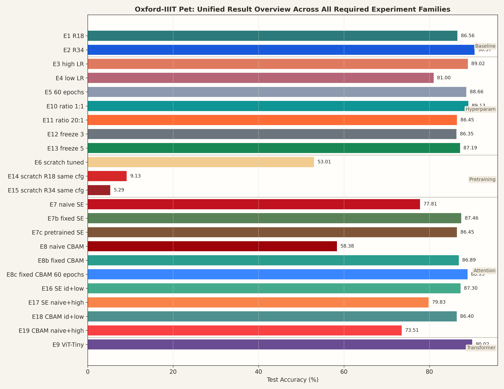
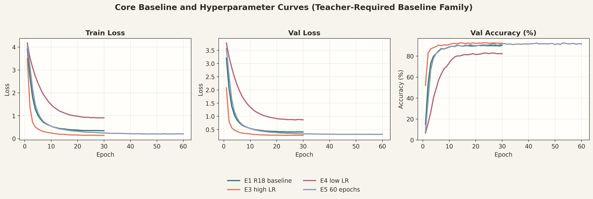
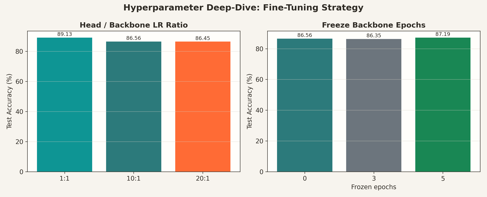
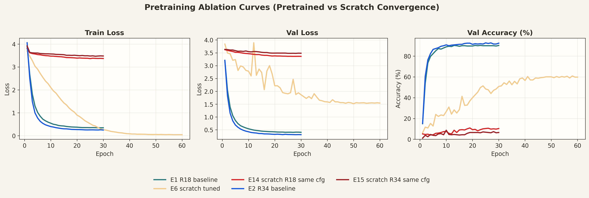
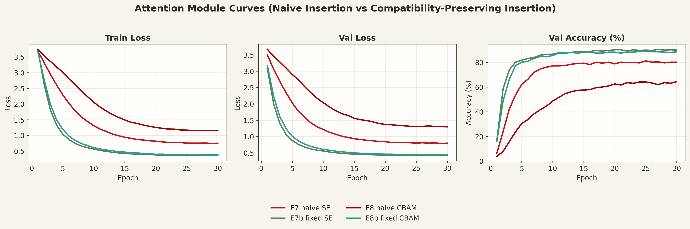
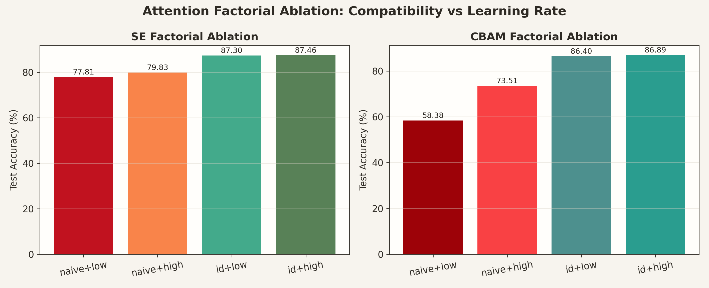

# Task 1 微调在 ImageNet 上预训练的卷积神经网络实现宠物识别

- 姓名：黄德超
- 学号：23300660009
- GitHub repo：https://github.com/adehuang41/cv_hw2_task1
- 模型权重：[Google Drive](https://drive.google.com/file/d/10FoC4MzjHDtPe9WaibzMaE00VgXoNHHN/view?usp=sharing)
- swanlab：https://swanlab.cn/@ade/hw2-task1/overview

## 1. 任务概述

本任务使用 Oxford-IIIT Pet Dataset 完成 37 类宠物品种分类。按照题目要求，我依次完成了四部分工作：

1. 以 ImageNet 预训练 `ResNet-18 / ResNet-34` 为 baseline，替换输出层后在宠物数据集上微调。
2. 分析训练步数、学习率及其组合对性能的影响。
3. 与随机初始化训练进行对比，分析预训练的作用。
4. 在 baseline 上引入注意力模块 `SE`、`CBAM`，并使用轻量级 `ViT-Tiny` 作为结构对照。

这份报告的主线不是“补做了多少实验”，而是围绕一个更有价值的问题展开：**在预训练网络上新增结构时，为什么有些改动会让性能变差，甚至明显差于 baseline？** 我最终认为，关键并不只是模块类型，而是这个新模块在初始化阶段是否与预训练表示兼容。

最终最佳测试结果来自 `ResNet-34 pretrained baseline`，测试集准确率为 `90.57%`。但本项目最有价值、也最区别于普通作业报告的结论是：**对预训练模型来说，新增模块的“预训练兼容性”比模块名字本身更重要。**

## 2. 数据集、模型与实验设置

### 2.1 数据集与划分

- 数据集：Oxford-IIIT Pet Dataset
- 任务类型：单标签 37 分类，因此评价指标采用 `Accuracy`，不使用 `mAP`
- 官方 `trainval`：`3680` 张，按 `9:1` 随机划分为训练集 `3312`、验证集 `368`
- 官方 `test`：`3669` 张，作为最终测试集
- 随机种子：`42`

数据处理实现位于 [src/data.py](/home/dechao/cv/hw2_task1/src/data.py:1)。训练增强为 `Resize -> RandomResizedCrop -> RandomHorizontalFlip -> ColorJitter -> Normalize`，验证与测试使用 `Resize -> CenterCrop -> Normalize`。

### 2.2 模型结构

模型构建位于 [src/models/build.py](/home/dechao/cv/hw2_task1/src/models/build.py:1)，注意力模块实现位于 [src/models/resnet_attn.py](/home/dechao/cv/hw2_task1/src/models/resnet_attn.py:1)。

- Baseline：`ResNet-18`、`ResNet-34`
  - 使用 ImageNet 预训练参数初始化主干
  - 将最终分类层替换为 `37` 类线性层，并从零开始训练
- 注意力模型：
  - 在 `ResNet-18 BasicBlock` 中，将 `SE` 或 `CBAM` 插入到第二个卷积后的 `bn2` 输出位置，并在残差相加前作用
- 轻量 Transformer：
  - 使用 `timm` 的 `ViT-Tiny`

特别地，我为 `SE` 和 `CBAM` 设计了 `identity initialization`。做法是将新增模块最后一层初始化为接近恒等映射，使其在训练初期不会强烈破坏原有的 ImageNet 特征。这一实现后来成为整份作业最关键的分析点。

### 2.3 训练设置

训练脚本位于 [src/train.py](/home/dechao/cv/hw2_task1/src/train.py:1)。

| 项目 | 设置 |
| ---- | ---- |
| 输入尺寸 | `224 x 224` |
| Batch size | `64` |
| Train iterations / epoch | `51`（`drop_last=True`） |
| Val iterations / epoch | `6` |
| Test iterations | `58` |
| Baseline 优化器 | `SGD(momentum=0.9)` |
| ViT 优化器 | `AdamW` |
| 学习率策略 | `1~2 epoch warmup + cosine decay` |
| 默认分类头学习率 | `1e-3` |
| 默认 backbone 学习率 | `1e-4` |
| attention 学习率 | `1e-4` 或 `1e-3` |
| 权重衰减 | ResNet `5e-4`，ViT `0.05` |
| 训练轮数 | `30` 或 `60` epochs |
| 损失函数 | Cross Entropy，ViT 使用 `label_smoothing=0.1` |
| 评价指标 | `best_val_acc` 与 `test_acc` |

代码中使用了三组参数学习率：

- 分类头 `head_lr`
- 预训练主干 `backbone_lr`
- 新增注意力模块 `attn_lr`

这比“全模型统一学习率”更符合微调场景，也使得后续超参数分析更有针对性。

### 2.4 可视化说明

所有实验都同步记录到了 SwanLab，同时在本地保存了 `logs/*.log` 和 `checkpoints/*/metrics.json`。由于总实验数较多，如果直接贴单个 SwanLab 截图会非常分散，不利于比较，因此本文将这些本地日志重新整合成多实验同图的曲线图。图中仍然包含老师要求的三类曲线：

- 训练集 `train loss`
- 验证集 `val loss`
- 验证集 `val accuracy`

## 3. 实验总览

表 1 给出所有正式实验的测试集结果，覆盖了题目要求的四条主线以及我额外补充的深入分析实验。

| 实验 | 模型 | 核心设置 | Test Acc |
| ---- | ---- | -------- | -------: |
| E1 | ResNet-18 | baseline，pretrained | 86.56% |
| E2 | ResNet-34 | baseline，pretrained | **90.57%** |
| E3 | ResNet-18 | 更大学习率 | 89.02% |
| E4 | ResNet-18 | 更小学习率 | 81.00% |
| E5 | ResNet-18 | 训练 60 epoch | 88.66% |
| E6 | ResNet-18 | scratch，更大 lr + 更长训练 | 53.01% |
| E7 | ResNet-18 + SE | naive 插入 SE | 77.81% |
| E7b | ResNet-18 + SE | identity init + 高 attn lr | 87.46% |
| E7c | SE-ResNet18 | 整体带 SE 预训练 | 86.45% |
| E8 | ResNet-18 + CBAM | naive 插入 CBAM | 58.38% |
| E8b | ResNet-18 + CBAM | identity init + 高 attn lr | 86.89% |
| E8c | ResNet-18 + CBAM | identity init，60 epoch | 88.93% |
| E9 | ViT-Tiny | pretrained | 90.02% |
| E10 | ResNet-18 | `head:backbone lr = 1:1` | 89.13% |
| E11 | ResNet-18 | `head:backbone lr = 20:1` | 86.45% |
| E12 | ResNet-18 | `freeze_backbone_epochs = 3` | 86.35% |
| E13 | ResNet-18 | `freeze_backbone_epochs = 5` | 87.19% |
| E14 | ResNet-18 | 与 E1 同配置，仅关闭预训练 | 9.13% |
| E15 | ResNet-34 | 与 E2 同配置，仅关闭预训练 | 5.29% |
| E16 | ResNet-18 + SE | identity init + 低 attn lr | 87.30% |
| E17 | ResNet-18 + SE | naive init + 高 attn lr | 79.83% |
| E18 | ResNet-18 + CBAM | identity init + 低 attn lr | 86.40% |
| E19 | ResNet-18 + CBAM | naive init + 高 attn lr | 73.51% |

  

从整体结果看，可以先得到三个总判断：

1. `ResNet-34 pretrained baseline` 仍是最佳最终模型，说明基础 baseline 本身已经很强。
2. 题目要求的四类实验都已经完整覆盖，而且主结论不是互相割裂的。
3. 我补做的 E10-E19 不是为了机械“加实验数”，而是为了把原来只停留在现象层面的结论，推进到更有解释力的因果分析。

## 4. 基础实验：Baseline 与超参数分析

这一节对应老师要求的前两部分：baseline 和超参数分析。这里必须先把基础实验讲清楚，后面的所有深入分析都建立在这组结果之上。

### 4.1 Baseline 对比

- `E1`：预训练 `ResNet-18`，测试集 `86.56%`
- `E2`：预训练 `ResNet-34`，测试集 `90.57%`

更深的 `ResNet-34` 明显优于 `ResNet-18`，说明在 Oxford-IIIT Pet 这种细粒度分类任务上，更强的预训练卷积特征仍然非常有效。也就是说，本项目最重要的对照对象不是一个“勉强能跑”的弱基线，而是一个已经达到 `90%+` 水平的强基线。

### 4.2 训练步数与学习率

题目要求分析训练步数、学习率及其组合，因此我先完成了基础超参数实验：

- `E3`：提高学习率
- `E4`：降低学习率
- `E5`：将训练轮数从 `30` 增加到 `60`

  

图中同时给出了 `train loss`、`val loss` 和 `val accuracy` 曲线，可以看到：

1. `E4` 的学习率过小，收敛明显变慢，验证精度长期落后，最终只有 `81.00%`。
2. `E3` 的较大学习率并没有破坏微调，反而将测试集提升到 `89.02%`，说明当前任务对 backbone 的更新不应过于保守。
3. `E5` 延长到 `60` epoch 后，验证曲线更平稳，但最终测试提升有限，说明单纯拉长训练不是最关键因素。

### 4.3 我对超参数部分的进一步思考

基础实验已经表明：这个任务不是“只要预训练了，怎么调都差不多”。因此我补做了 `E10-E13`，专门分析微调时预训练主干的更新方式。

  

在超参数子图中可以看到：

- `E10 (1:1)` 达到 `89.13%`，优于原始 `E1 (10:1)` 和 `E11 (20:1)`。
- `E13 (freeze 5)` 达到 `87.19%`，优于 `E12 (freeze 3)` 和不冻结的 `E1`。

这说明对预训练模型而言，真正重要的不是“学习率大还是小”这么简单，而是**分类头与主干的更新强度如何匹配**。如果把 backbone 压得太死，模型很难充分适配宠物数据集；但如果训练初期完全不做任何保护，主干也可能被过快扰动。因此：

- `epoch` 是有用的，但不是最关键旋钮；
- `head/backbone lr ratio` 和 `freeze_backbone_epochs` 更能体现 fine-tuning 的本质。

## 5. 预训练消融：预训练到底带来了什么

这一节对应老师要求的第三部分。

原始实验中，`E6` 已经给出了“从随机初始化开始训练”的结果：即使把学习率调大、训练拉长到 `60` epoch，测试集也只有 `53.01%`。这个结果已经能说明预训练很重要，但还不够严格，因为它并不是和 baseline 完全同配置的公平对照。

因此我进一步补做了：

- `E14`：与 `E1` 完全同配置，只是关闭预训练
- `E15`：与 `E2` 完全同配置，只是关闭预训练

  

从曲线和最终结果可以得到非常清晰的结论：

1. `E1 pretrained R18` 很快收敛到 `90%` 左右的验证精度，而 `E14 scratch R18 same cfg` 基本停留在 `10%` 左右，几乎接近随机猜测。
2. 即使给 scratch 模型更大的学习率和更长训练，`E6` 也只能恢复到 `53.01%`，远低于预训练 baseline。
3. 更深的 `ResNet-34` 在无预训练时更差，`E15` 只有 `5.29%`，说明更强模型并不会自动弥补数据不足问题。

因此，我对“预训练作用”的理解不再只是“收敛更快”：

- 对这个任务来说，ImageNet 预训练首先决定了模型是否能在有限训练预算内学到有效特征；
- 预训练不是一个小幅 bonus，而是主效应；
- 如果忽略这一点，后续所有结构比较都可能失真。

## 6. 注意力机制与轻量 Transformer 对比

这一节对应老师要求的第四部分。

### 6.1 基础结构对比

先看题目要求的基础结构实验：

- `E7`：`ResNet-18 + SE`，naive 插入，`77.81%`
- `E8`：`ResNet-18 + CBAM`，naive 插入，`58.38%`
- `E7b`：修复初始化后的 `SE`，`87.46%`
- `E8b`：修复初始化后的 `CBAM`，`86.89%`
- `E7c`：`timm legacy_seresnet18`，即“整体带 SE 且整体预训练”的网络，`86.45%`
- `E8c`：修复后的 `CBAM` 训练 `60` epoch，`88.93%`
- `E9`：`ViT-Tiny`，`90.02%`

`ViT-Tiny` 的测试集结果非常接近 `ResNet-34 baseline`，说明轻量 Transformer 在这个任务上是有竞争力的；但它并没有稳定超过强 CNN baseline，因此本作业的主角仍然是卷积网络微调，而不是简单地“换一个模型就更强”。

### 6.2 为什么 naive attention 会明显退化

如果只看最终精度，很容易得出一个粗糙结论：`SE` 和 `CBAM` 都“不太行”。但这其实是不对的，因为 `E7b`、`E8b`、`E8c` 已经证明，只要处理方式合理，带注意力的模型完全可以恢复到接近甚至超过 baseline 的水平。

  

从曲线可以看到：

1. `E7` 和 `E8` 在训练早期就明显落后于修复版，说明问题不是“后期没训够”，而是插入模块后立刻破坏了预训练特征。
2. `E7b` 和 `E8b` 使用 identity initialization 后，验证曲线几乎立刻恢复到正常 fine-tuning 轨道。
3. `SE` 的 naive 退化没有 `CBAM` 那么严重，说明模块复杂度越高，对预训练特征分布的扰动也可能越大。

### 6.3 我最重视的结论：模块名不是关键，兼容性才是关键

为了验证“到底是初始化问题，还是注意力模块学习率不够”这一点，我又补做了 `E16-E19` 的 2×2 因子消融。

  

在这张因子消融图中可以看到：

- SE：
  - `naive + low lr = 77.81%`
  - `naive + high lr = 79.83%`
  - `id + low lr = 87.30%`
  - `id + high lr = 87.46%`
- CBAM：
  - `naive + low lr = 58.38%`
  - `naive + high lr = 73.51%`
  - `id + low lr = 86.40%`
  - `id + high lr = 86.89%`

这个结果非常关键，因为它把“经验观察”变成了“机制判断”：

1. 单纯提高 `attn_lr` 只能部分缓解问题，无法从根本上修复 naive attention。
2. 只要使用 `identity initialization`，即便 `attn_lr` 保持较低，也能恢复大部分性能。
3. 因此真正决定成败的，并不是 `SE` 还是 `CBAM`，而是新增模块在训练开始时是否近似恒等映射，是否与预训练特征兼容。

我认为这也是本项目最值得老师看到的“自己的思考”：**在预训练模型上做结构改造时，新增模块首先要做到“不破坏”，然后才谈得上“学习到额外收益”。**

## 7. 结论

围绕老师要求的四部分，本项目的最终结论如下：

1. `ResNet-34 pretrained baseline` 是整体最佳模型，测试集准确率为 `90.57%`。
2. 超参数分析表明，微调阶段的关键不只是训练轮数，更在于 `head/backbone lr ratio` 和训练初期是否适度冻结 backbone。
3. 预训练消融表明，ImageNet 预训练是 Oxford-IIIT Pet 上最主要的性能来源；same-config scratch 几乎崩溃到 `9.13%` 和 `5.29%`。
4. 引入注意力模块时，真正重要的不是“用了 SE 还是 CBAM”，而是新增模块是否与预训练表示兼容。`identity initialization` 是恢复性能的决定性因素。
5. `ViT-Tiny` 表现很强，但在当前数据规模和训练预算下并未稳定超过最强 CNN baseline。

如果只把这次作业理解为“微调一个预训练网络”，那么结论是 `ResNet-34` 最好；但如果进一步追问“为什么有些改动会让预训练网络变差”，那么这份作业更有价值的答案是：**预训练网络最脆弱的地方，不是容量不够，而是后续结构改动是否尊重了它已经学好的表示。**

## 8. 复现与提交信息

- 代码仓库：[https://github.com/adehuang41/cv_hw2_task1](https://github.com/adehuang41/cv_hw2_task1)
- 模型权重：[Google Drive](https://drive.google.com/file/d/10FoC4MzjHDtPe9WaibzMaE00VgXoNHHN/view?usp=sharing)
- 主要训练脚本：[src/train.py](/home/dechao/cv/hw2_task1/src/train.py:1)
- 数据与增强：[src/data.py](/home/dechao/cv/hw2_task1/src/data.py:1)
- 模型实现：[src/models/resnet_attn.py](/home/dechao/cv/hw2_task1/src/models/resnet_attn.py:1)

报告中使用的主要图表文件如下：

| 文件 | 说明 |
| ---- | ---- |
| `report/assets/final_overview.png` | 所有实验结果总览 |
| `report/assets/final_core_curves.png` | baseline 与基础超参数曲线 |
| `report/assets/final_pretraining_curves.png` | 预训练消融曲线 |
| `report/assets/final_attention_curves.png` | 注意力模块曲线 |
| `report/assets/final_hparam_deep_dive.png` | 超参数深入分析图 |
| `report/assets/final_attention_factorial.png` | 注意力因子消融图 |
