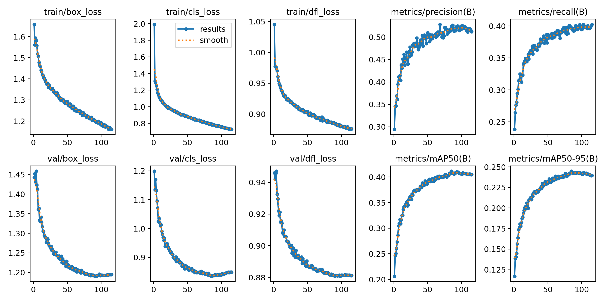
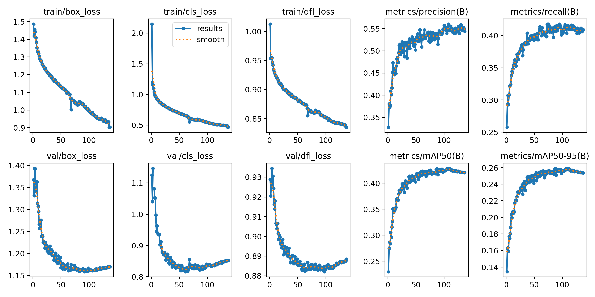
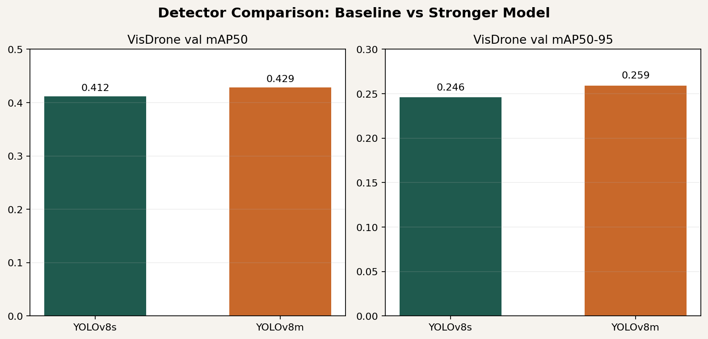
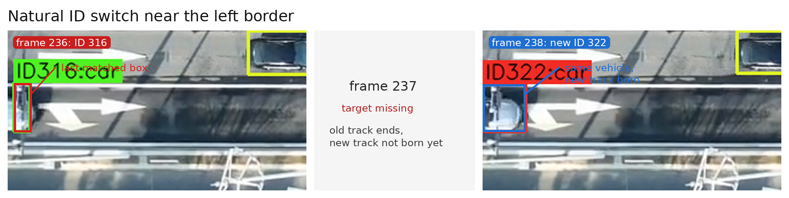
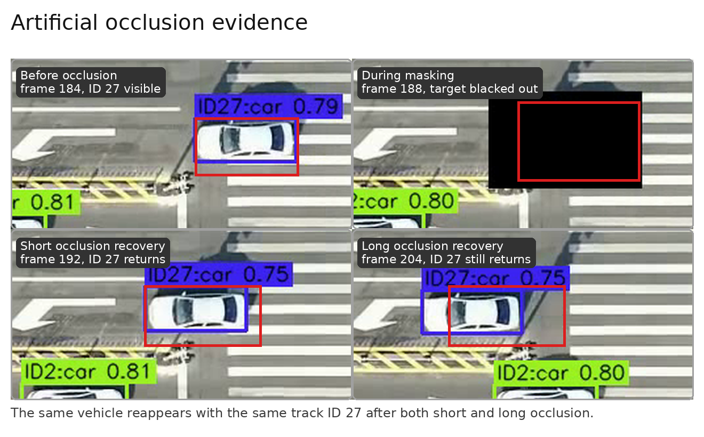
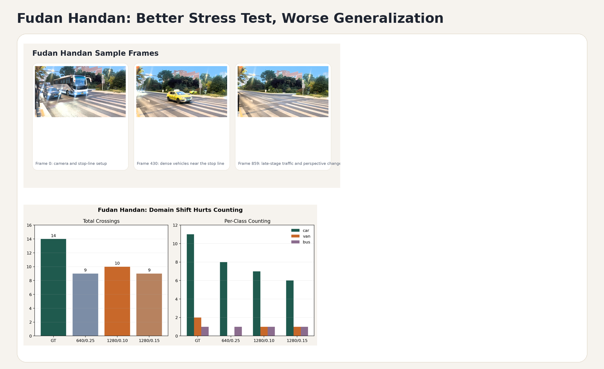

# Task 2 基于 VisDrone 的目标检测、跟踪与交通视频分析

- 姓名：黄德超
- 学号：23300660009
- GitHub repo：[https://github.com/adehuang41/cv_hw2_task2](https://github.com/adehuang41/cv_hw2_task2)
- 模型权重：https://drive.google.com/file/d/1181_K1THxbxi584ephFJekuBFCrbwqRu/view?usp=drive_link
- swanlab：https://swanlab.cn/@ade/hw2-task2/overview

## 1. 任务概述

本任务要求先在公开数据集上训练目标检测模型，再把模型迁移到新视频中，完成多目标跟踪和一个下游分析任务。我最终把整个项目组织成三层：

1. 在 VisDrone-DET 上微调 `YOLOv8` 检测器。
2. 在无人机交通视频上接入 `ByteTrack`，输出稳定的目标轨迹。
3. 在轨迹之上做遮挡分析与虚拟线越线计数。

这份报告想回答三个具体问题：

1. `YOLOv8m` 相比 `YOLOv8s`，是否真的带来稳定提升？
2. 视频中的 `ID switch` 到底主要来自遮挡，还是来自边界漏检与检测中断？
3. 如果检测指标有所提升，这个提升能否真正传导到视频级应用结果上？

我额外引入两部分分析：

1. 在主视频上做自然场景的 `ID switch` 诊断与人工遮挡实验。
2. 再加入一段域外视频 `fudan_handan.mp4`，专门观察系统在分布偏移场景下的退化模式。

## 2. 数据集、模型与实验设置

### 2.1 数据集与任务

- 训练数据集：`VisDrone-DET`
- 任务类型：目标检测
- 检测类别数：`10`
- 训练集：`6471` images
- 验证集：`548` images
- 测试集：`1610` images（`test-dev`）

本任务不是分类问题，因此最终评价指标不是 `Accuracy`，而是目标检测常用的 `Precision / Recall / mAP50 / mAP50-95`。

### 2.2 视频数据

本项目用到了两段视频。

主视频是 `new_drone_video.mp4`。脚本运行时使用的是它的工作副本 `data/videos/test_clip.mp4`。两者内容相同，只是为了方便脚本统一路径。该视频为 `1920 x 1080`，`30 FPS`，共 `511` 帧，时长约 `17.03 s`。

第二段视频是 `fudan_handan.mp4`。它的视角、车辆密度和场景结构都与主视频不同，因此更适合拿来观察域外泛化能力。该视频同样为 `1920 x 1080`，约 `29.99 FPS`，共 `860` 帧。

### 2.3 模型结构

模型部分由一个检测器和一个跟踪器组成。

- 检测器：`YOLOv8s` 与 `YOLOv8m`
- 跟踪器：`ByteTrack`
- 深度学习框架：`PyTorch`
- 检测实现：`Ultralytics YOLOv8`

`YOLOv8` 负责逐帧输出边界框和类别；`ByteTrack` 负责将相邻帧中的检测结果关联成持续轨迹。这个设计有两个好处：

1. 训练与视频推理可以解耦，便于先比较检测器，再比较视频级结果。
2. 如果视频中出现错误，可以较清楚地区分问题主要出在检测端还是关联端。

### 2.4 训练设置

训练脚本位于 `src/train.py`，训练配置位于 `configs/train_yolov8s.yaml` 与 `configs/train_yolov8m.yaml`。核心设置如下。

| 项目 | YOLOv8s | YOLOv8m |
| ---- | ---- | ---- |
| 预训练权重 | `yolov8s.pt` | `yolov8m.pt` |
| 输入尺寸 | `640` | `640` |
| Batch size | `32` | `96` |
| Train iterations / epoch | `ceil(6471/32)=203` | `ceil(6471/96)=68` |
| 最大 epoch | `150` | `150` |
| 实际训练 epoch | `115` | `137` |
| optimizer | `auto` | `auto` |
| 初始学习率 `lr0` | `0.01` | `0.01` |
| 最终学习率比例 `lrf` | `0.01` | `0.01` |
| momentum | `0.937` | `0.937` |
| weight decay | `5e-4` | `5e-4` |
| warmup epochs | `3` | `3` |
| scheduler | cosine LR | cosine LR |
| patience | `30` | `30` |
| mosaic | `1.0` | `0.5` |
| mixup | `0.1` | `0.0` |
| close_mosaic | `15` | `15` |
| workers | `8` | `16` |
| cache | `false` | `ram` |
| AMP | `True` | `True` |
| 随机种子 | `42` | `42` |
| device | `GPU 7` | `GPU 7` |

### 2.5 损失函数与评价指标

YOLOv8 检测训练使用其标准检测损失：

- `box loss`
- `cls loss`
- `dfl loss`

评估指标包括：

- `Precision`
- `Recall`
- `mAP50`
- `mAP50-95`
- `per-class AP`

视频分析部分额外使用：

- 轨迹连续性观察
- `ID switch` 案例分析
- 虚拟线越线计数

## 3. 检测实验结果

### 3.1 YOLOv8s 基线结果

首先训练 `YOLOv8s @ 640` 作为基线。它最终在早停机制下训练了 `115` 个 epoch，验证与测试结果如下。

| 模型 | val mAP50 | val mAP50-95 | test-dev mAP50 | test-dev mAP50-95 |
| ---- | ----: | ----: | ----: | ----: |
| YOLOv8s | `0.4120` | `0.2460` | `0.3260` | `0.1910` |

这个结果说明基线已经具备较强的可用性，不是一个“勉强能跑”的弱模型。后续所有视频分析和对比实验，都是建立在这个基线之上。

下图是 `YOLOv8s` 的训练曲线。

从曲线可以看出，训练前期损失下降较快，验证集 mAP 在中后期趋于稳定，最后在 patience 触发后提前停止。这说明模型已经基本收敛，继续训练的收益有限。

### 3.2 YOLOv8m 结果与对比

为了判断更大的检测器是否值得引入，我又训练了 `YOLOv8m @ 640`。该模型最终训练记录到 `137` 个 epoch，其中最佳验证结果出现在 `107` epoch。

| 模型 | best epoch | best val mAP50 | best val mAP50-95 |
| ---- | ----: | ----: | ----: |
| YOLOv8m | `107` | `0.42877` | `0.25916` |

用最终 `best.pt` 重新评估后，得到如下结果。

| 模型 | val mAP50 | val mAP50-95 | test-dev mAP50 | test-dev mAP50-95 |
| ---- | ----: | ----: | ----: | ----: |
| YOLOv8m | `0.4295` | `0.2602` | `0.3383` | `0.2004` |

和 `YOLOv8s` 相比，`YOLOv8m` 在四个核心检测指标上都更高：

- `val mAP50: 0.4120 -> 0.4295`
- `val mAP50-95: 0.2460 -> 0.2602`
- `test-dev mAP50: 0.3260 -> 0.3383`
- `test-dev mAP50-95: 0.1910 -> 0.2004`

这说明更大模型带来的提升并不是偶然波动，而是在验证集和测试集上都能观察到的稳定提升。

`YOLOv8m` 的训练曲线整体也比较平稳。虽然中途经历过恢复，但从最终结果看，恢复没有破坏训练趋势，也没有影响最佳模型的保存。

下面这张图汇总了两种检测器的差异。

如果只看检测指标，这一节的结论已经很清楚：`YOLOv8m` 是更强的检测器。但本项目真正关心的问题还没完全回答，因为更强的检测器未必自动等于更好的视频级结果。后面的跟踪、遮挡与计数实验就是为了验证这一点。

## 4. 主视频上的跟踪与计数

### 4.1 主视频结果

主视频 `new_drone_video.mp4` 用来展示完整流程是否真正跑通。基线推理使用 `YOLOv8s + ByteTrack`，检测配置为 `imgsz=640, conf=0.25, iou=0.5`。

视频级结果如下：

- 总检测记录约 `12,791`
- 粗略唯一轨迹 ID 数约 `78`
- 主虚拟线越线总数为 `18`
- 主要类别全部为 `car`

### 4.2 置信度阈值消融

检测置信度消融结果如下。

| conf | mean dets/frame | unique IDs (rough) | line crossings |
| ----: | ----: | ----: | ----: |
| `0.15` | `25.85` | `76` | `18` |
| `0.25` | `25.03` | `78` | `18` |
| `0.35` | `24.03` | `67` | `18` |
| `0.50` | `22.92` | `46` | `18` |

随着 `conf` 提高，检测框数量和粗略轨迹数都明显下降，但越线计数始终保持 `18` 不变。也就是说，这段主视频上的计数结果对阈值并不敏感。

所以：在主视频中，主车流足够明显，所以系统的计数稳定性并不依赖于极端精细的阈值调整。

### 4.3 更高分辨率实验：为什么会多出 motor

除了 `YOLOv8s @ 640 / conf=0.25` 的基线外，我还补做了两组更高输入分辨率实验：

| 设置 | car | van | motor | 合计 |
| ---- | ----: | ----: | ----: | ----: |
| `640 / conf=0.25` | `18` | `0` | `0` | `18` |
| `1280 / conf=0.10` | `16` | `2` | `3` | `21` |
| `1280 / conf=0.15` | `16` | `2` | `3` | `21` |

这些结果对应于 `outputs/compare/` 目录下的三组对比输出。这个实验很重要，因为它解释了为什么后续我会继续补做 `YOLOv8m`：

1. 仅仅把输入分辨率从 `640` 提高到 `1280`，就已经能够检出先前完全漏掉的 `motor`。
2. 这说明主视频里的主要漏计对象不是大车流本身，而是更小、更边缘、更难检出的目标。
3. 但高分辨率并没有简单地“把一切都变对”，因为它同时引入了 `van` 这类新的类别分配。

换句话说，这个实验表明：**主视频上的误差不只是阈值问题，还包含小目标召回与类别分配问题。**

### 4.4 主视频人工计数 vs 模型计数

我对主视频 `new_drone_video.mp4` 做了人工回放计数。人工 GT 结果如下：

- `car = 18`
- `motor = 4`
- 总计 `22`

人工核验时，我把虚拟线固定为 `x=1280` 的竖线，并逐个检查目标是否真正完成越线；同一物体若在线附近抖动或短暂停留，只记一次，不重复累计。这样可以尽量把“真实越线数”和“轨迹抖动造成的伪触发”区分开。

据此可以把几组模型结果放在同一张表里比较：

| 设置 | car | van | motor | 合计 | 与人工 GT 的主要差异 |
| ---- | ----: | ----: | ----: | ----: | ---- |
| 人工 GT | `18` | `0` | `4` | `22` | `-` |
| `YOLOv8s 640 / conf=0.25` | `18` | `0` | `0` | `18` | 少 `4 motor` |
| `YOLOv8s 1280 / conf=0.10` | `16` | `2` | `3` | `21` | 少 `2 car`，多 `2 van`，少 `1 motor` |
| `YOLOv8s 1280 / conf=0.15` | `16` | `2` | `3` | `21` | 与上组几乎相同 |
| `YOLOv8m 1280 / conf=0.15` | `16` | `2` | `4` | `22` | 少 `2 car`，多 `2 van`，`motor` 已恢复 |

这张表显示：

1. 基线 `640` 配置对主车流计数是准确的，但对 `motor` 完全漏检。
2. 提高到 `1280` 之后，`motor` 开始出现，说明分辨率提升确实改善了小目标召回。
3. 但高分辨率同时把部分 `car` 分到了 `van`，因此总数变接近不代表类别结构已经正确。
4. `YOLOv8m` 的总数恰好达到人工 GT 的 `22`，而且把 `motor=4` 全部找回来了；不过它依然保留了 `car -> van` 的类别偏移。

所以，对主视频最准确的结论不是“`YOLOv8m` 更强，所以完全更准”，而是：

- 它明显提升了小目标和边缘目标的召回；
- 它把主视频总数追到了人工 GT；
- 但类别层面仍存在结构性误差。

从误差类型看，主视频上的主要问题并不是重复计数，而是漏检和类别误识：`640` 配置几乎把全部误差都集中在 `motor` 漏检上；分辨率和模型增强之后，总数更接近人工 GT，但部分 `car` 又被分到了 `van`。这说明当前计数模块本身是稳定的，瓶颈更多仍在检测端。

### 4.5 YOLOv8m 在主视频上的影响

为了判断更强的检测器是否也能改善视频级结果，我只在最优配置上做了一组轻量对比，而没有像 `YOLOv8s` 一样做大规模网格实验。这样做的原因很简单：这里的目标不是再做一轮完整调参，而是回答“更大模型值不值得补做”。

`YOLOv8m` 在主视频上的配置为 `imgsz=1280, conf=0.15, iou=0.5`，结果如下。

| 模型 | 配置 | 总越线数 | 主要类别分布 |
| ---- | ---- | ----: | ---- |
| YOLOv8s | `640 / conf=0.25` | `18` | `car = 18` |
| YOLOv8m | `1280 / conf=0.15` | `22` | `car = 16, van = 2, motor = 4` |

`YOLOv8m` 的确把主视频总数从 `18/21` 提升到了与人工 GT 一致的 `22`，而且把 `motor` 全部恢复出来了；但它并没有完全修正类别偏差，所以更合理的说法是“**更强模型改善了召回和总数，但没有完全解决分类偏移**”。

## 5. 遮挡与 ID switch 分析

### 5.1 自然场景中的真实失败案例

`ByteTrack` 的基本做法是：先用 `Kalman Filter` 预测轨迹在下一帧的位置，再优先用高置信度检测做匹配，必要时再用低置信度检测去“救回”暂时变弱的目标；如果某一帧完全没有匹配上，旧轨迹会先进入 `lost` 状态，后续重新出现的检测若没能和旧轨迹成功关联，就会被当作新 ID 注册。因此，它既可能在短时遮挡后维持原 ID，也可能在检测中断后出现 `ID switch`。

在 `test_clip.mp4` 的 `frame 236 -> 238` 附近，左边界附近的一辆车先被跟踪为 `ID 316`，随后发生单帧中断，紧接着又以新 ID `322` 被重新建立轨迹。

这张局部放大图比整帧更清楚：同一辆车只在左边界附近移动了很短距离，却在 `frame 236` 还是 `ID 316`，到 `frame 238` 就变成了 `ID 322`。中间`frame 237`是一次短暂的检测中断。

这里的核心问题并不是“遮挡太严重”，而更可能是“边界附近框不完整，导致短时漏检”。一旦检测断掉，旧轨迹先进入 `lost`，新的检测再被注册成新轨迹，就会表现为明显的 `ID switch`。

也就是说，在这段视频里，跟踪算法并没有成功维持原有 ID，最终发生了 `316 -> 322` 的 `ID switch`。结合 ByteTrack 的机制看，这里的主要诱因是边界漏检导致的关联中断，而不是长时间遮挡或轨迹运动模型本身崩溃。

### 5.2 人工遮挡实验

我还补做了人工遮挡实验。实验对象是主视频中原本跟踪很稳定的一辆车，其原始轨迹 ID 为 `28`。

我构造了两组遮挡：

| 实验 | 遮挡帧范围 | 结果 |
| ---- | ---- | ---- |
| 短遮挡 | `186-190` | 无 `ID switch` |
| 长遮挡 | `186-200` | 仍无 `ID switch` |

第二张图里黑色方块就是人工加上的遮挡区域；第三、四张图说明同一辆车在短遮挡和长遮挡之后都重新以 `ID 27` 出现。

这个结果和自然场景中的 `316 -> 322` 恰好形成了对照。它说明 ByteTrack 并不是“只要目标被挡住就一定重新编号”。当目标运动连续、邻近干扰有限、遮挡时长仍在恢复窗口内时，原 ID 是可以保住的。

换句话说，面对这个场景时，跟踪器有两种不同表现：在自然片段里，由于边界附近的单帧漏检，原 ID 没有保住；在人工遮挡实验里，由于目标的运动趋势更平滑、重现位置也更可预测，ByteTrack 成功把遮挡前后的检测继续关联到同一条轨迹上。这也符合课堂上“跟踪质量强依赖检测连续性”的结论。

因此，我最终把这一部分的结论概括为：

1. `ID switch` 不能笼统地归因于“遮挡”两个字。
2. 边界漏检、短时检测中断、场景拥挤程度和轨迹可恢复性会共同决定最终结果。
3. 对这个项目来说，提升检测连续性可能比盲目更换跟踪器更关键。

## 6. 域外视频与泛化分析

### 6.1 为什么要加入第二段视频

为了检验模型在分布偏移场景下的表现，我加入了 `fudan_handan.mp4`。

这段视频和主视频相比，存在几个更困难的因素：

1. 视角不同，目标尺度变化更明显。
2. 车辆停走更频繁，互相遮挡更多。
3. 停止线附近的交互更复杂，更容易引发误检和类别混淆。

### 6.2 YOLOv8s 在 fudan_handan 上的结果

我先在 `YOLOv8s` 上做了几组停止线计数实验，并手工统计了人工 GT：

- `car = 11`
- `van = 2`
- `bus = 1`
- 总计 `14`

完整的三组对比如下：

| 设置 | pedestrian | car | van | bus | 合计 | 与人工 GT 的主要差异 |
| ---- | ----: | ----: | ----: | ----: | ----: | ---- |
| 人工 GT | `1` | `11` | `2` | `1` | `15` | `-` |
| `640 / conf=0.25` | `0` | `8` | `0` | `1` | `9` | 少 `3 car`、少 `2 van`、`1 pedestrian` |
| `1280 / conf=0.10` | `1` | `7` | `1` | `1` | `10` | 少 `4 car`、少 `1 van` |
| `1280 / conf=0.15` | `1` | `6` | `1` | `1` | `9` | 少 `5 car`、少 `1 van`|

这里能看到一个和主视频不同的现象：在 `fudan_handan` 上，提高输入分辨率带来的提升非常有限，`1280 / conf=0.10` 虽然是三组里总数最高的，但依然与人工 GT 差了 `5` 个目标

这个结果已经能看出明显域偏移

### 6.3 YOLOv8m 在 fudan_handan 上的结果

随后我用 `YOLOv8m` 只补做了一组最佳配置对比，配置为 `imgsz=1280, conf=0.10, iou=0.5`。

| 模型 | 配置 | 总数 | 主要类别分布 |
| ---- | ---- | ----: | ---- |
| YOLOv8s | `1280 / conf=0.10` | `10` | `car = 7, van = 1, bus = 1, pedestrian = 1` |
| YOLOv8m | `1280 / conf=0.10` | `12` | `car = 9, truck = 1, pedestrian = 2` |
| 人工 GT | `-` | `14` | `car = 11, van = 2, bus = 1` |

这个结果很有代表性。`YOLOv8m` 的总数确实更接近人工 GT，说明更大的检测器缓解了一部分漏检问题；但它并没有彻底解决域偏移。

## 7. 结论

本项目最终完成了从检测训练、视频跟踪到交通统计分析的完整流水线，并得到以下结论。

1. `YOLOv8s + ByteTrack` 已经能够在主视频 `new_drone_video.mp4` 上稳定工作，完成轨迹输出和越线计数。
2. `YOLOv8m` 在检测层面稳定优于 `YOLOv8s`，并且这种提升同时体现在验证集和测试集上。
3. 在主视频上，`YOLOv8m` 扩大了检测覆盖范围，但由于缺少完整人工 GT，不能简单把“计数更多”解释成“计数更准”。
4. 真实视频中的 `ID switch` 更可能来自边界漏检与短时检测中断，而不是“遮挡必然导致失败”。
5. 人工遮挡实验进一步说明，ByteTrack 在条件合适时可以跨遮挡保持原 ID，因此系统脆弱性的关键不只在跟踪器，也在检测连续性。
6. 在域外视频 `fudan_handan.mp4` 上，`YOLOv8m` 虽然比 `YOLOv8s` 更接近人工 GT，但类别混淆和泛化退化依然明显。

## 8. 代码与复现说明

主要代码入口如下：

- `src/prepare_visdrone.py`：准备 VisDrone 数据
- `src/train.py`：训练 YOLOv8s / YOLOv8m
- `src/eval.py`：在 `val` 与 `test-dev` 上评估
- `src/track_video.py`：视频检测与跟踪
- `src/extract_occlusion.py`：抽取 `ID switch` 片段
- `src/line_counter.py`：虚拟线越线计数
- `src/conf_ablation.py`：置信度阈值消融
