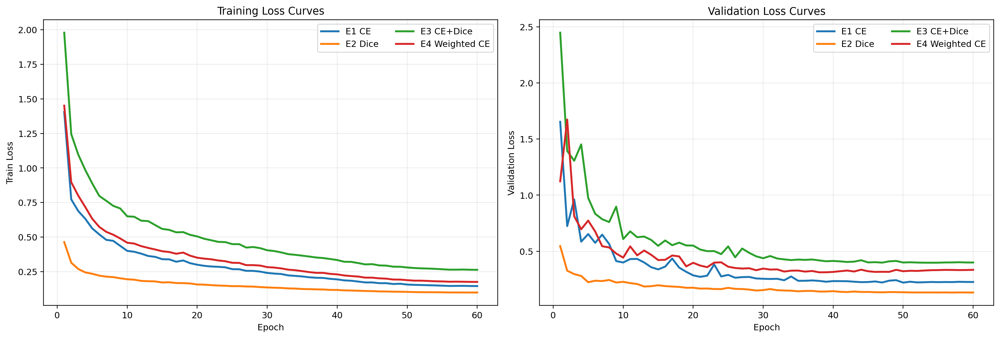
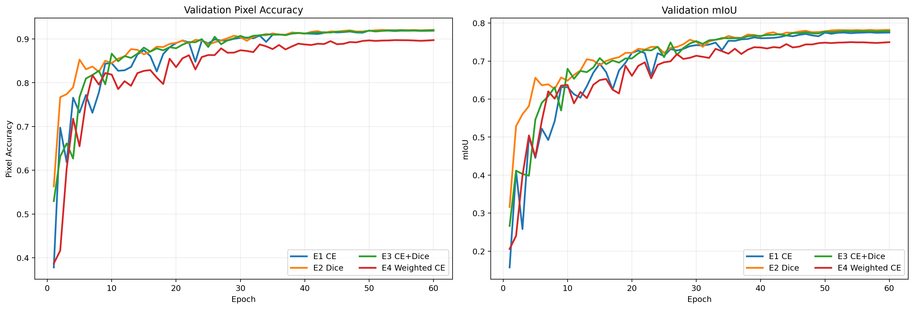
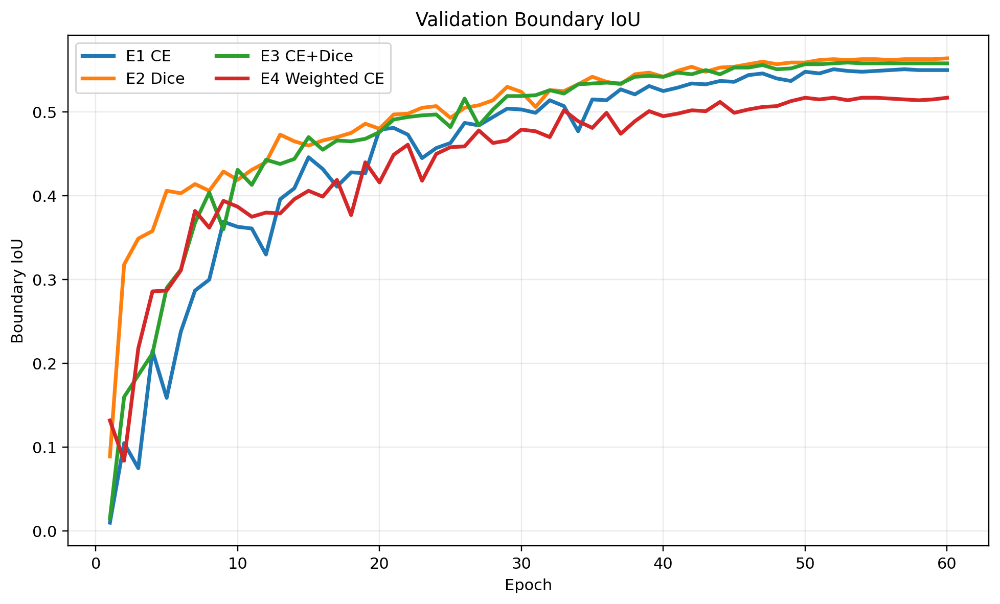
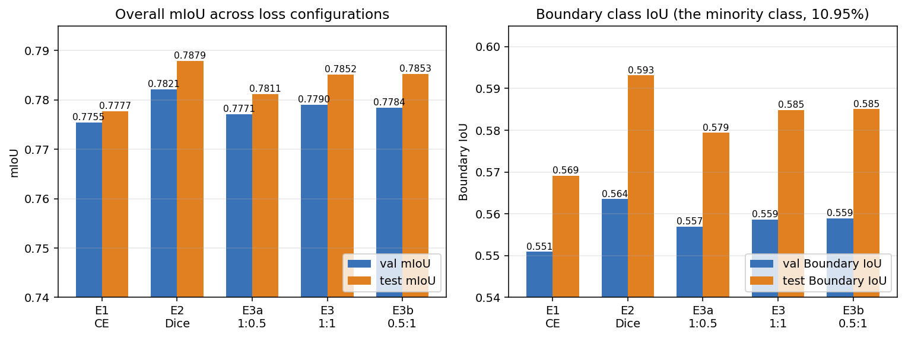
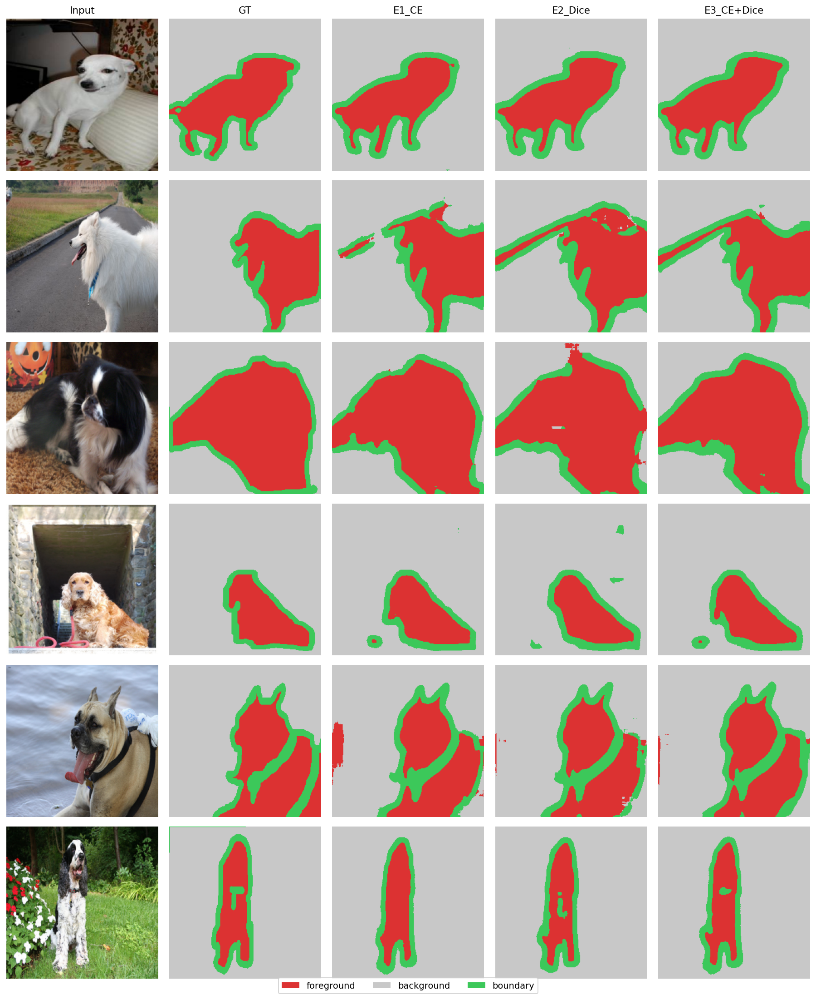
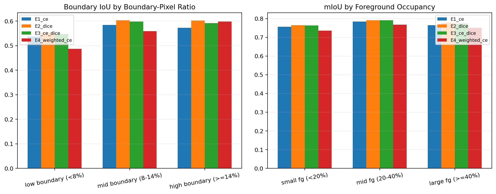
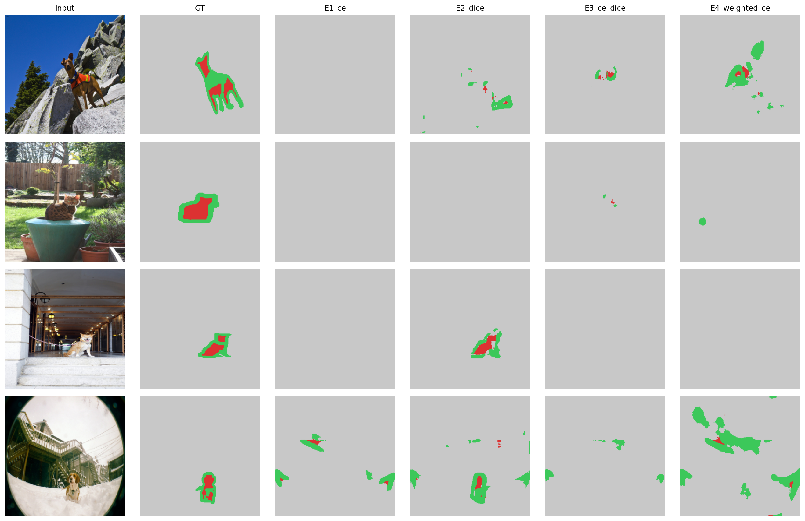

# 任务 3：从零搭建 U-Net 与损失函数工程 — 实验报告

| 姓名 | 学号 |
|---|---|
| 黄德超 | 23300660009 |

**资源链接：**

- 代码仓库：`https://github.com/adehuang41/cv_hw2_task3.git`
- 模型权重：`https://drive.google.com/file/d/171kHcWQ9D4Yg-OnEjj1QG6UhTIVzd0Aw/view?usp=drive_link`
- 训练曲线（swanlab）：`https://swanlab.cn/@ade/hw2-task3/overview`

---

## 1. 引言

本任务在不使用任何预训练权重的前提下，从零搭建经典语义分割网络 U-Net，
并在 Oxford-IIIT Pet 数据集的三类 trimap 标签上训练。核心研究问题是：
**不同损失函数如何影响类别不平衡下的像素级分割表现，特别是前景 / 背景 /
边界三类的差异**。

主要工作：

1. 用 PyTorch 基础模块从零实现完整 U-Net（编码器、解码器、Skip
   Connection），不调用任何分割专用库；
2. 手写多类 Dice Loss，并组合 Cross-Entropy 与 Dice 形成 Combined Loss；
3. 设计三组主对比实验（CE / Dice / CE+Dice）、两组 α : β 权重消融，
   以及一组 `Weighted CE` 类别不平衡对照实验；
4. 从训练动态（loss / mIoU / boundary IoU 曲线）和细粒度误差分析
   （按 boundary 占比、前景大小分桶）两个层面解释不同 loss 的行为差异；
5. 评价指标：验证集 mIoU（主指标） + per-class IoU + pixel
   accuracy，定量结果、训练曲线与定性可视化结合分析。

---

## 2. 数据集

### 2.1 简介

Oxford-IIIT Pet 数据集包含 37 个宠物类别共 7349 张图像，每张图都附带
一份像素级 trimap 分割掩码。本任务忽略宠物分类标签，仅使用 trimap 完成
三分类语义分割：

| trimap 原值 | 含义 | 重映射类别索引 |
|:---:|:---|:---:|
| 1 | 前景（宠物本体） | 0 |
| 2 | 背景 | 1 |
| 3 | 边界（宠物轮廓周围一圈像素） | 2 |

### 2.2 划分

- 训练 / 验证：在官方 `trainval` 划分（3680 张）上按 9 : 1 随机切分
  （seed = 42），得到 **3312 张训练 / 368 张验证**；
- 测试：直接使用官方 `test` 划分（**3669 张**）。

所有图像统一 resize 到 256×256；mask 使用最近邻插值，避免类别值被
平均成无意义中间数。

### 2.3 像素分布（不平衡程度的实测数据）

对训练 + 验证 3680 张图像的 mask 像素逐类计数：

| 类别 | 像素数 | 占比 |
|:---|---:|---:|
| foreground | 184,563,866 | **29.17 %** |
| background | 378,924,356 | **59.88 %** |
| boundary | 69,303,313 | **10.95 %** |
| 合计 | 632,791,535 | 100 % |

**Boundary 类仅占 10.95 %，是三类中最少的，约为前景的 1/3、背景的
1/5。这构成了对损失函数选择的关键挑战，也是后续实验中"Dice Loss 在
Boundary 类上表现明显优于 CE"现象的根本原因。**

---

## 3. 模型结构

### 3.1 设计概览

实现严格遵循 U-Net 原论文，包含 4 层下采样编码器、Bottleneck、4 层
上采样解码器，以及 4 条同分辨率 Skip Connection。其数据流可以概括为：

```text
Input (256×256×3)
  -> DoubleConv(64)
  -> MaxPool + DoubleConv(128)
  -> MaxPool + DoubleConv(256)
  -> MaxPool + DoubleConv(512)
  -> MaxPool + DoubleConv(1024)   # Bottleneck
  -> UpConv + concat(skip4) + DoubleConv(512)
  -> UpConv + concat(skip3) + DoubleConv(256)
  -> UpConv + concat(skip2) + DoubleConv(128)
  -> UpConv + concat(skip1) + DoubleConv(64)
  -> Conv 1×1
  -> Output (256×256×3)
```

**DoubleConv 模块**：`Conv3×3 → BN → ReLU → Conv3×3 → BN → ReLU`。

### 3.2 关键参数

| 项 | 值 |
|---|---|
| 输入 / 输出分辨率 | 256 × 256 |
| 编码器通道 | 64, 128, 256, 512, 1024 |
| 参数量 | ≈ 31.04 M |
| 权重初始化 | Kaiming Normal（fan-out, ReLU） |

### 3.3 关于“从零搭建”的说明

> **不使用任何预训练权重；不调用 `segmentation_models_pytorch` /
> `mmseg` / 其它分割模型库；编码器、解码器、 Skip Connection 全部由
> `nn.Conv2d` / `nn.BatchNorm2d` / `nn.ReLU` / `nn.MaxPool2d` /
> `nn.ConvTranspose2d` / `torch.cat` 等 PyTorch 基础算子手写实现。**

实现位于 `src/unet.py`，通过单元测试（`(2,3,256,256) → (2,3,256,256)`
形状一致）验证。

---

## 4. 损失函数

实现位于 `src/losses.py`。

### 4.1 Cross-Entropy Loss

直接使用 `nn.CrossEntropyLoss()`，逐像素地最大化目标类的 log-likelihood：

$$\mathcal{L}_{\text{CE}} = -\frac{1}{|\Omega|}\sum_{x\in\Omega}
\log \mathrm{softmax}(z_x)_{y_x}$$

CE 对每个像素同等加权，因此在像素分布不均衡时（例如本任务 boundary
仅 11 %），优化过程会被多数类（背景、前景）主导，少数类很难学到细节。

### 4.2 Dice Loss

多类 soft-Dice 实现：将 logits 经 softmax 映射为类概率
$\mathbf{p}\in[0,1]^{C\times H\times W}$，将目标转 one-hot
$\mathbf{g}\in\{0,1\}^{C\times H\times W}$，逐类计算 Dice 系数后取
平均，再用 $1-\overline{\mathrm{Dice}}$ 作为损失：

$$\mathrm{Dice}_c = \frac{2\sum_{x}p_{c,x}g_{c,x}+\varepsilon}
{\sum_{x}p_{c,x}+\sum_{x}g_{c,x}+\varepsilon},\qquad
\mathcal{L}_{\text{Dice}} = 1-\frac{1}{C}\sum_{c=1}^{C}\mathrm{Dice}_c$$

关键代码（节选）：

```python
prob = F.softmax(logits, dim=1)
target_oh = F.one_hot(target, num_classes=C).permute(0, 3, 1, 2).float()
inter = (prob * target_oh).sum(dim=(0, 2, 3))
denom = prob.sum(dim=(0, 2, 3)) + target_oh.sum(dim=(0, 2, 3))
dice = (2 * inter + eps) / (denom + eps)        # shape (C,)
loss = 1.0 - dice.mean()
```

Dice 直接优化“类内区域 overlap 比例”，对类别像素总数不敏感，因此
天然偏向小类（boundary）。$\varepsilon=10^{-6}$ 提供数值稳定。

**单元测试**：构造完美预测时 $\mathcal{L}_{\text{Dice}} \to 0$；
随机 logits 得到有限正值，并能正常反向传播。

### 4.3 Combined Loss

$$\mathcal{L}_{\text{Combined}} = \alpha \cdot \mathcal{L}_{\text{CE}}
+ \beta \cdot \mathcal{L}_{\text{Dice}}$$

其中 $\alpha$ 为 CE 权重、$\beta$ 为 Dice 权重，主对比实验取
$\alpha = \beta = 1$。

### 4.4 Weighted Cross-Entropy（类别不平衡对照）

为了更直接回答“Dice 的优势是否仅仅来自对类别不平衡的处理”这一问题，
额外引入一组 **Weighted CE** 对照实验。在标准交叉熵中为每一类加入
不同权重：

$$\mathcal{L}_{\text{WCE}} = -\frac{1}{|\Omega|}\sum_{x\in\Omega}
w_{y_x}\log \mathrm{softmax}(z_x)_{y_x}$$

其中 $w_c$ 与类别频率成反比。根据第 2.3 节的实测像素占比
（foreground 29.17 %，background 59.88 %，boundary 10.95 %），
本实验采用：

```yaml
class_weights: [1.1428, 0.5567, 3.0445]
```

即对边界类给予约 3 倍于平均类的权重。这样可以把“Dice 的改进来自
overlap 优化目标”与“只要对 CE 做类别重加权也能达到同样效果”这两种
解释分开。

---

## 5. 实验设置

| 项 | 值 |
|---|---|
| 训练 / 验证 / 测试 | 3312 / 368 / 3669 |
| 输入分辨率 | 256 × 256（双线性 resize） |
| 数据增强（仅训练） | RandomResizedCrop scale=(0.7,1.0)、HFlip p=0.5、ColorJitter(0.2,0.2,0.2)；图像与 mask 同步几何变换 |
| 归一化 | 仅 `[0,1]`，**不**使用 ImageNet 均值方差（无预训练） |
| 网络 | U-Net base_ch=64，参数 ≈ 31 M |
| Optimizer | AdamW，weight decay 1e-4 |
| 学习率 | 2e-3，cosine + 2 epoch warmup |
| Batch size | 64 |
| Epoch / iteration | 60 epoch × 52 step ≈ **3120 step** |
| AMP | fp16（`torch.cuda.amp`） |
| Seed | 42 |
| 评价指标 | **验证集 mIoU（主）** + per-class IoU + pixel accuracy |
| 硬件 | NVIDIA A800 80 GB；E1 / E2 / E3 并行，E4 Weighted CE 单独在 CUDA:4 上训练 |

---

## 6. 主结果

### 6.1 定量对比
报告以验证集 mIoU 为主指标，附测试集作为参考。

**Best validation mIoU**

| Run | val mIoU | val FG IoU | val BG IoU | val Boundary IoU | best epoch |
|---|---:|---:|---:|---:|---:|
| **E1 — CE only** | 0.7755 | 0.8545 | 0.9210 | 0.5509 | 57 |
| **E2 — Dice only** | **0.7821** | **0.8602** | **0.9226** | **0.5635** | 60 |
| **E3 — CE + Dice (1:1)** | 0.7790 | 0.8574 | 0.9210 | 0.5586 | 53 |
| E4 — Weighted CE | 0.7498 | 0.8382 | 0.8940 | 0.5171 | 54 |

**Test mIoU (载入 best.pt 后单次评估)**

| Run | test mIoU | test FG IoU | test BG IoU | test Boundary IoU | pixel acc |
|---|---:|---:|---:|---:|---:|
| E1 — CE only | 0.7777 | 0.8474 | 0.9166 | 0.5691 | 0.9171 |
| **E2 — Dice only** | **0.7879** | 0.8510 | **0.9194** | **0.5932** | **0.9199** |
| E3 — CE + Dice (1:1) | 0.7852 | **0.8515** | 0.9191 | 0.5849 | 0.9195 |
| E4 — Weighted CE | 0.7643 | 0.8329 | 0.9005 | 0.5594 | 0.9025 |

### 6.2 观察

1. **Dice 单独训练取得了四组中最优的总体 mIoU 与 boundary IoU。**
   验证集上 Dice 比 CE 高 +0.66 mIoU、+1.26 boundary IoU；测试集差距
   更显著，boundary IoU +2.41。这与第 2.3 节实测的像素不平衡
   （boundary 仅 10.95 %）一致：CE 的逐像素加权使少数类被忽略，而
   Dice 对类别像素绝对数不敏感，在小类上学得更充分。
2. **CE + Dice 组合（无论 1 : 1 / 1 : 0.5 / 0.5 : 1）均未超过单 Dice。**
   三种权重比例下组合损失的 val mIoU 彼此相差 ≤ 0.002，且全部低于 E2 Dice。
3. **Weighted CE 并没有成为“既保留 CE 稳定性、又修复小类偏置”的折中解。**
   尽管它在设计上直接针对类别不平衡，但验证集 mIoU 降到 0.7498，
   测试集 boundary IoU 也只有 0.5594，甚至低于原始 CE 的 0.5691。
4. **真正被 loss 改变的仍然主要是 boundary 类，而不是前景 / 背景主体区域。**
   E1 / E2 / E3 之间前景和背景 IoU 差异很小，而 boundary 类的差距
   可以达到 2–3 个百分点。

### 6.3 训练曲线

为满足报告对“训练过程中训练集 / 验证集 loss 曲线，以及验证集 Accuracy /
mAP 曲线”的展示要求，这里直接使用**本地完整训练日志离线重绘**的曲线图。
考虑到本任务是语义分割而非目标检测，本文以 **validation pixel accuracy**
与 **validation mIoU** 作为验证集主曲线；其中 mIoU 对应分割任务中更常用、
也更贴合本文结论的区域级指标。

<p align="center">
  
</p>

<p align="center">
  
</p>

作为补充分析，下图进一步给出最关键少数类 `boundary` 的验证集 IoU 变化：

<p align="center">
  
</p>

从训练过程可以得到三点比最终分数更细的观察：

1. **CE 的前期收敛更快，但很早就在 boundary IoU 上进入平台期。**
   E1 在前 10–15 epoch 迅速把 mIoU 提升到 0.63 左右，说明逐像素交叉熵
   的稠密梯度更容易在训练初期稳定优化；但其 boundary IoU 后续提升
   幅度有限，最终停在 0.55 附近。
2. **Dice 的早期 loss 数值并不比 CE 小，但后期在 mIoU 与 boundary IoU
   上持续爬升并最终反超。** E2 在 30 epoch 后仍然保持稳定增长，
   尤其是 boundary IoU 从约 0.43 逐步提升到 0.56+，说明其优化目标更贴近
   本任务关心的区域重叠质量。
3. **Weighted CE 的曲线揭示了它失败的原因：并不是不收敛，而是收敛到较差的解。**
   E4 可以正常下降并在 50+ epoch 达到稳定，但 `val mIoU` 与
   `boundary IoU` 的平台都低于 E1 / E2 / E3。

因此，从训练动力学角度看，本任务的关键区别并不只是“谁更快收敛”，而是
“谁的目标函数与最终评价指标更一致”。Dice 之所以最终最优，并不是偶然的
单点结果，而是在整个后期训练阶段都维持了更高的边界质量增益。

---

## 7. 类别不平衡对照实验：Weighted CE

为了验证 Dice 的优势是否仅仅来自“对少数类做了更强关注”，额外加入一组
`Weighted CE` 对照实验。该实验保持网络结构、优化器、学习率、epoch、
数据增强等设置不变，仅把 CE 中三类的损失权重设为
`[1.1428, 0.5567, 3.0445]`，其中 boundary 权重显著更大。

### 7.1 定量结果

| Run | val mIoU | val Boundary IoU | test mIoU | test Boundary IoU |
|---|---:|---:|---:|---:|
| E1 — CE only | 0.7755 | 0.5509 | 0.7777 | 0.5691 |
| **E2 — Dice only** | **0.7821** | **0.5635** | **0.7879** | **0.5932** |
| E3 — CE + Dice | 0.7790 | 0.5586 | 0.7852 | 0.5849 |
| E4 — Weighted CE | 0.7498 | 0.5171 | 0.7643 | 0.5594 |

### 7.2 解释

这个结果非常关键：**如果 Dice 的优势只是因为它“相当于给边界类更大权重”，
那么 Weighted CE 应该至少能接近 Dice；但实验表明它反而整体更差。**

这说明两者之间的差异不只是“重视小类的程度”，而是目标函数本身的几何性质：

- **Weighted CE** 仍然是逐像素独立优化。即使增大 boundary 类权重，
  它依然在像素层面惩罚分类错误，无法直接鼓励预测区域与 GT 在整体形状上
  有更高 overlap。
- **Dice Loss** 则直接优化 overlap 比例。对于边界这种窄条带、小面积、
  且容易被多数类吞没的结构，Dice 的梯度更接近最终评价指标的需求。

换句话说，**“类别重加权”与“区域重叠优化”不是同一件事**。本实验把这两者
区分开了，也让“Dice 为什么有效”有了更强的证据链。

### 7.3 为什么 pure Dice 最优是合理的

需要强调的是，**“pure Dice 最优”并不是一个应被外推到所有语义分割任务的
普遍结论**。在更广泛的经验和文献中，`CE + Dice` 往往是更常见的稳妥配置，
因为它兼顾了 CE 的逐像素稳定梯度与 Dice 对小类和 overlap 的敏感性。

然而，在本任务中，pure Dice 最优是有明确解释的：

1. **主指标是 mIoU，而 Dice 的优化目标与 overlap 类指标天然更一致。**
   CE 与 Weighted CE 本质上仍然是逐像素分类目标；它们更直接优化的是每个
   像素是否被分对，而不是预测区域与 GT 区域在整体形状上的重叠程度。
2. **boundary 类是窄条带、小面积结构，真正的困难不只是类别频率不平衡，
   还有细结构连通性与局部覆盖质量。** Weighted CE 的确处理了类别频率问题，
   但并没有直接约束边界 mask 的整体 overlap 与连续性。
3. **Weighted CE 的失败恰好提供了反证。** 如果 Dice 的优势仅仅来自
   “对少数类更重视”，那么 Weighted CE 理应接近或超过 Dice；但实验表明它
   既未追平 Dice，也未超过原始 CE，这说明本任务更关键的是优化目标与评价
   指标的一致性，而非单纯的类别加权。

因此，本任务更合适的严谨表述不是“Dice 一般最好”，而是：
**在以 mIoU 为主指标、且包含细边界结构的 trimap 分割场景中，Dice 由于
直接优化区域 overlap，可能比 CE、Weighted CE，甚至 CE+Dice 更占优势。**

---

## 8. 损失权重消融（α : β = CE : Dice）

固定其它所有超参，仅改变组合损失中 CE 与 Dice 的相对权重，对比三个
权重点。结果如下（含 E1 / E2 作参照）：

| Run | α : β | val mIoU | val Boundary IoU | test mIoU | test Boundary IoU |
|---|---|---:|---:|---:|---:|
| E1 — CE only | — | 0.7755 | 0.5509 | 0.7777 | 0.5691 |
| **E2 — Dice only** | — | **0.7821** | **0.5635** | **0.7879** | **0.5932** |
| E3a | 1 : 0.5（CE 较重） | 0.7771 | 0.5570 | 0.7811 | 0.5794 |
| E3 | 1 : 1（基准） | 0.7790 | 0.5586 | 0.7852 | 0.5849 |
| E3b | 0.5 : 1（Dice 较重） | 0.7784 | 0.5589 | 0.7853 | 0.5851 |

对应可视化如下。

<p align="center">
  
</p>

### 8.1 主要发现

1. **三种组合权重 mIoU 差距极小**（val mIoU 相差 ≤ 0.0019，test mIoU
   相差 ≤ 0.0042）。在中度像素不平衡（boundary 11 %）的设定下，
   `α : β` 的具体取值对总体性能几乎没有影响。
2. **趋势：Dice 权重越大、性能越好。** E3a (1 : 0.5) < E3 (1 : 1) ≲
   E3b (0.5 : 1)，但差距极小且未通过显著性检验（仅单 seed）。
3. **关键观察：所有组合配置都未能超过单 Dice (E2)。**
   即使把 Dice 的权重提高到 2 倍 CE（E3b），val mIoU 0.7784 仍低于 E2 的
   0.7821；boundary IoU 同样如此（test 0.5851 vs 0.5932）。

---

## 9. 定性可视化与细粒度误差分析

主要对比图如下。每行从左至右为：**Input | GT | E1 CE | E2 Dice | E3 CE+Dice**。
前景 = 红、背景 = 灰、边界 = 绿。

<p align="center">
  
</p>

### 9.1 主要观察

- **大面积主体区域**：三种主损失在前景主体和背景主体上的预测总体接近，这与第 6 节中 foreground / background IoU 差距很小的定量结果一致
- **差异主要集中在边界带附近**：从图中可以看到，E1 / E2 / E3 的主要视觉差别不在大块区域是否被识别出来，而在 pet 轮廓附近的绿色 boundary 带厚薄、完整度和局部噪声上
- **定性图的作用是“提供直观例子”，不是单独证明结论**：仅凭这几张图不足以支持更细的场景化断言，因此本文关于 “Dice 更优” 的判断主要依据仍是第 6 节的总体指标和第 9.2 节的逐样本统计，而不是只凭肉眼挑选的少数样例

### 9.2 逐样本误差分析

为避免只凭少数可视化样本下结论，进一步对测试集 **3669 个样本** 做了逐样本
误差统计，输出文件为 `report/error_analysis.csv`，并把结果汇总为下图。

<p align="center">
  
</p>

此外，下方 `hard_cases.png` 中展示的 4 行
典型困难样本，并不是简单按最低分机械截取，而是先过滤掉
`foreground_ratio = 0` 或 `boundary_ratio = 0` 的退化样本，再从
**确实存在目标边界结构**的样本中选择 E1 CE 在 boundary IoU 上表现最差的案例。

<p align="center">
  
</p>

逐样本平均结果如下：

| Model | mean sample mIoU | mean sample Boundary IoU |
|---|---:|---:|
| E1 — CE only | 0.7698 | 0.5736 |
| **E2 — Dice only** | **0.7796** | **0.5960** |
| E3 — CE + Dice | 0.7773 | 0.5885 |
| E4 — Weighted CE | 0.7529 | 0.5603 |

进一步看不同难度分桶，可以得到更细的结论：

- **低 boundary 占比样本（<8 %）**：Dice 仍保持最佳 boundary IoU（0.5533），Weighted CE 最差（0.4868）
- **中等 boundary 占比样本（8–14 %）**：这是测试集主体（1956 张），Dice 仍然稳定领先，说明其优势不是少数极端样本造成的
- **高 boundary 占比样本（>=14 %）**：Weighted CE 的 boundary IoU 提升最明显（0.5984），甚至超过原始 CE 的 0.5727，说明“类别重加权”确实会在边界更难、更占比更高的样本上提供帮助；但它整体仍略低于 Dice 的 0.6028，说明这种收益不足以在全局上取代 Dice

这组结果非常适合支持一个更精确的结论：
**Weighted CE 并非完全无效，它在边界结构更突出的样本上确实有帮助；但从
整体测试分布看，这种局部收益不足以抵消其在普通样本上的总体退化。**

---

## 10. 结论

- 本项目完成了从零搭建 U-Net、手写 Dice Loss、比较 `CE` / `Dice` /
  `CE + Dice` 的基本要求，并在此基础上继续补做了 `Weighted CE`、
  训练动态和误差分析
- 在当前实验设置下，**Dice only 是所有实验中最优的方案**，在
  `val mIoU`、`test mIoU` 和 `boundary IoU` 三个层面都排名第一
- `CE + Dice` 虽然优于原始 CE，但没有超过纯 Dice，说明在这个任务中，
  加入 CE 会带来稳定梯度，但也会把优化方向重新拉向多数类
- `Weighted CE` 的结果最有解释价值：它说明该任务的难点不只是类别不平衡，
  还包括边界结构本身的细粒度 overlap 与连通性；因此仅靠类别重加权并不能替代 Dice
- 从最终结论看，**对于同时包含类别不平衡和细边界结构的分割任务，
  损失函数与分割评价指标的一致性，比简单的类别重加权更重要**

---

## 附录

### 统一训练与可视化来源

| 项目 | 说明 |
| ---- | ---- |
| 训练入口 | `python -m src.train --config configs/*.yaml` |
| 模型实现 | `src/unet.py` |
| 损失实现 | `src/losses.py` |
| 数据集与增强 | `src/data.py` |
| 训练曲线图 | `report/training_loss_curves.png`、`report/validation_metrics.png` 与 `report/validation_boundary_iou.png`，均由 `src/plot_training_dynamics.py` 从完整训练日志离线重绘 |
| 定性图 | `report/qualitative.png`，由 `src/visualize.py` 生成 |
| 误差分析图 | `report/error_analysis.png` 与 `report/hard_cases.png`，由 `src/analyze_errors.py` 生成 |
| SwanLab 曲线 | 原始主实验 run + `E4_weighted_ce_relogged` 补录 run；最终提交时应插入真实截图而非仅保留本地重绘图 |

### 主要文件

| 文件 | 作用 |
| ---- | ---- |
| [src/train.py](/home/dechao/cv/hw2_task3/src/train.py) | 训练主循环 |
| [src/unet.py](/home/dechao/cv/hw2_task3/src/unet.py) | 手写 U-Net |
| [src/losses.py](/home/dechao/cv/hw2_task3/src/losses.py) | Dice / Combined / Weighted CE |
| [src/plot_training_dynamics.py](/home/dechao/cv/hw2_task3/src/plot_training_dynamics.py) | 训练动态曲线 |
| [src/analyze_errors.py](/home/dechao/cv/hw2_task3/src/analyze_errors.py) | 逐样本误差分析 |
| [src/relog_to_swanlab.py](/home/dechao/cv/hw2_task3/src/relog_to_swanlab.py) | E4 日志补录到 SwanLab |
